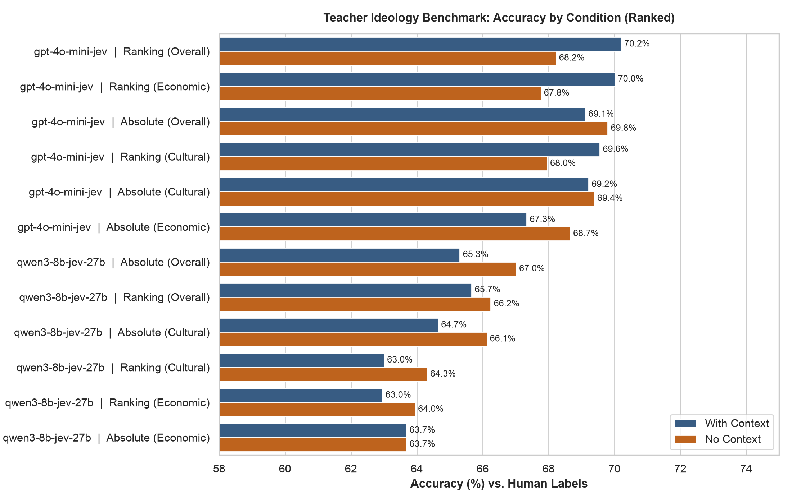

# YouTube Ideology Classifier

Classification of political ideology in YouTube videos along overall, economic, and cultural (GAL-TAN) ideological axes. The pipeline distills LLM teacher supervision (pairwise ranking and pointwise scoring) into sentence-transformer student embeddings.

## Teacher Evaluation Benchmark

Evaluated on 4,152 human pairwise judgments across 2,162 unique political videos (`data/human_labels/human_labels.pkl`).



## Pipeline

The workflow is managed via `Makefile`:

```bash
# Setup
make venv
make install

# Teacher Inference
make teacher-context
make teacher-pairs
make eval-teacher

# Benchmark & Visualization
make benchmark

# Student Model Training
make wrangle
make train CONFIG=configs/small_ranked.yaml

# Local vLLM Servers
make serve-qwen8b
make serve-jev27b
make serve-qwen-flash

```
